# TP2 — Architecture Microservices avec Spring Cloud

**Filière :** BDCC III · **Module :** Architecture des Systèmes Distribués et Middleware
**Encadrant :** Pr. Mohamed YOUSSFI · **Réalisé par :** Mohammed EL HIMAR · **Date :** Octobre 2026

---

## 1. Objectif

Construire une application bancaire de facturation découpée en 6 microservices Spring Cloud, avec routage, découverte de services, appels inter-services, résilience et configuration centralisée.

| Service | Port | Rôle |
|---|---|---|
| `customer-service` | 8081 | Gestion des clients (Spring Data REST, H2) |
| `inventory-service` | 8082 | Gestion des produits (Spring Data REST, Actuator) |
| `billing-service` | 8083 | Gestion des factures (OpenFeign, Resilience4j) |
| `gateway-service` | 8888 | Point d'entrée unique, routage et load balancing |
| `discovery-service` | 8761 | Registre Eureka |
| `config-service` | 9999 | Configuration centralisée |

Un client n'appelle que la Gateway. Celle-ci cherche le service dans Eureka, puis route la requête vers une instance disponible.

## 2. Customer et Inventory

Les deux services exposent leurs données via Spring Data REST, sans contrôleur écrit à la main :

```java
@RepositoryRestResource
public interface CustomerRepository extends JpaRepository<Customer, Long> {}
```

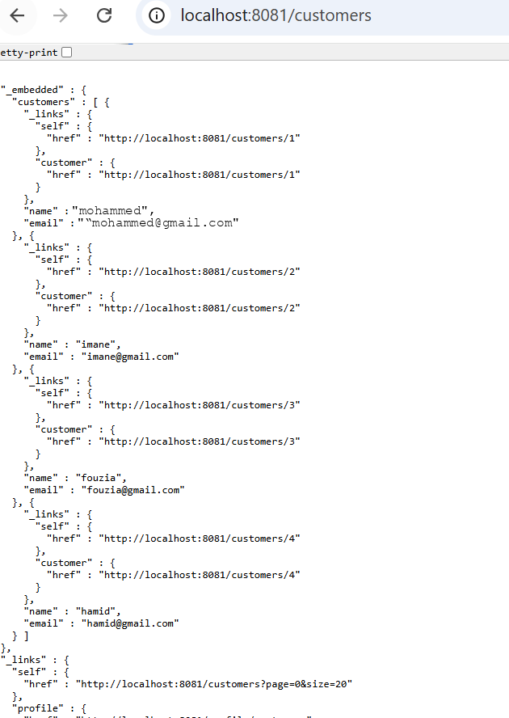

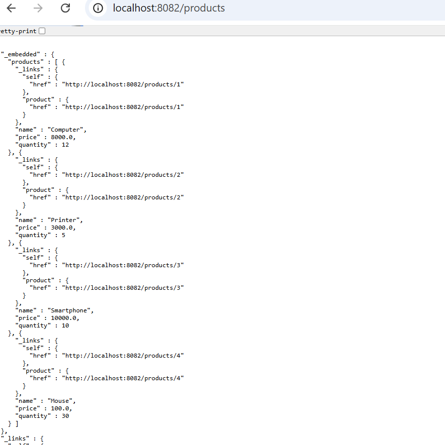

Spring Actuator expose l'état du service. `management.endpoints.web.exposure.include=*` active tous les endpoints :

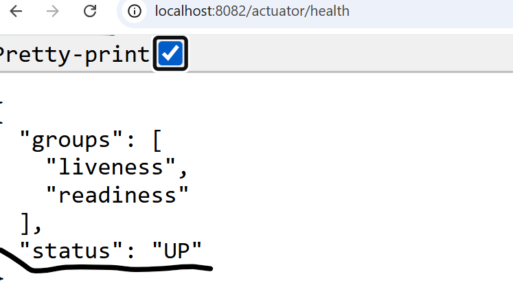

## 3. Gateway : routage statique puis dynamique

**Routage statique** : chaque route pointe vers une URL fixe.

**Routage dynamique** : la route pointe vers un nom logique, résolu par Eureka. `lb://` active aussi le load balancing.

```yaml
routes:
  - id: r1
    uri: lb://CUSTOMER-SERVICE
    predicates:
      - Path=/customers/**
```

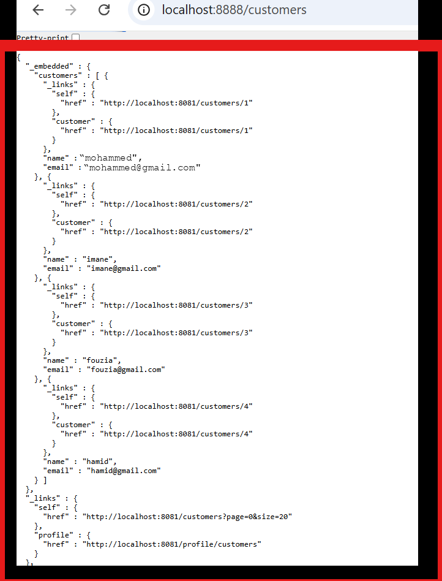

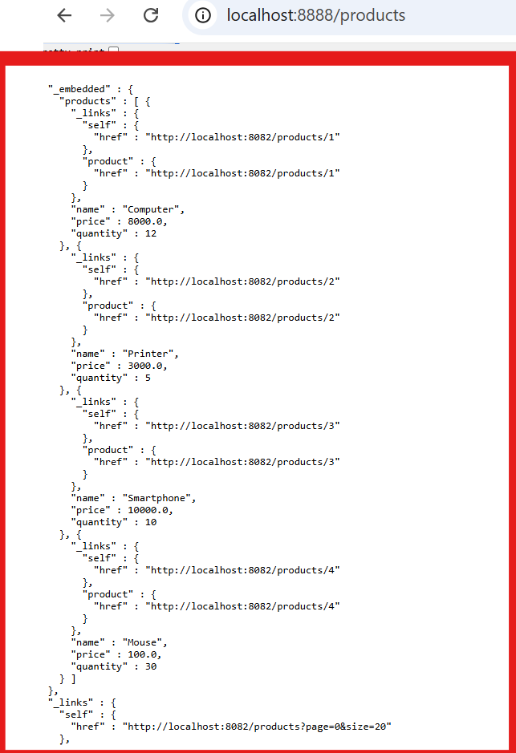

Une route dynamique sur tous les services enregistrés est aussi possible avec `DiscoveryClientRouteDefinitionLocator` : la Gateway expose alors `/CUSTOMER-SERVICE/...` et `/INVENTORY-SERVICE/...` sans configuration manuelle.

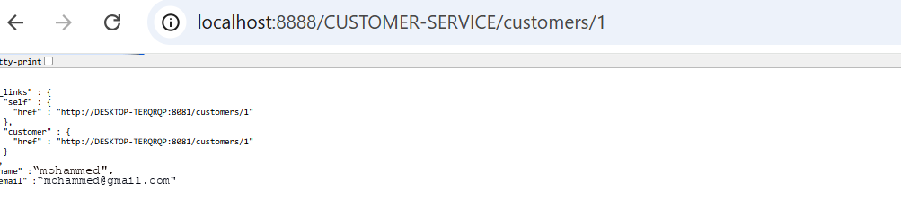

## 4. Discovery : Eureka

Chaque microservice s'enregistre au démarrage avec son nom et son URL. Le serveur Eureka est activé par une annotation :

```java
@SpringBootApplication
@EnableEurekaServer
public class DiscoveryServiceApplication { ... }
```

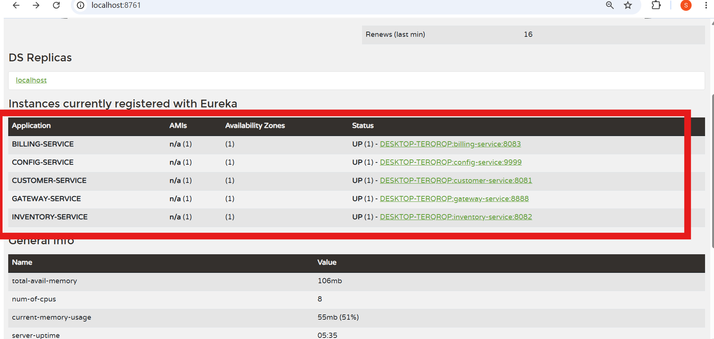

## 5. Billing : communication avec OpenFeign

Une facture contient un identifiant client et des lignes de produits. Pour afficher la facture complète, `billing-service` appelle les deux autres services avec des interfaces déclaratives :

```java
@FeignClient("customer-service")
public interface CustomerServiceRestClient {
    @GetMapping("/customers/{id}")
    Customer findCustomerById(@PathVariable Long id);
}
```

`@EnableFeignClients` doit être présent sur la classe principale pour activer ces interfaces.

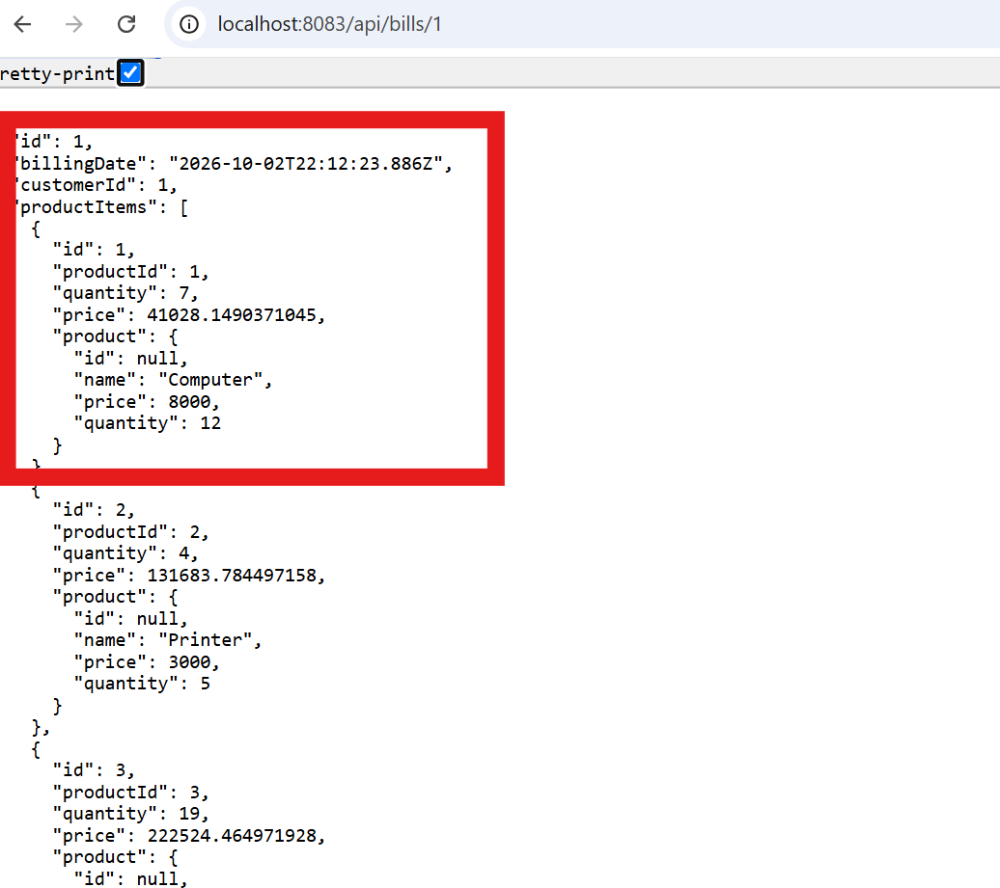

## 6. Résilience : Circuit Breaker

Si `customer-service` est arrêté, l'appel échoue et toute la facture échoue avec lui. Un `@CircuitBreaker` avec méthode de fallback renvoie une valeur par défaut :

```java
@CircuitBreaker(name = "customer-service", fallbackMethod = "getDefaultCustomer")
Customer findCustomerById(@PathVariable Long id);
```

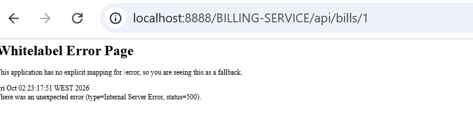

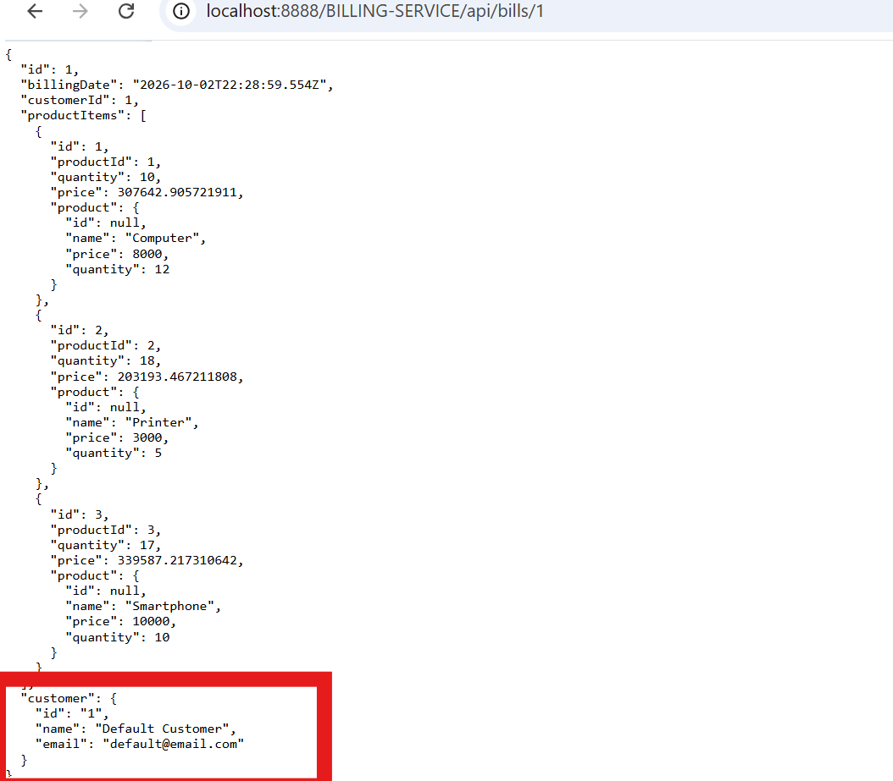

## 7. Config Service et rafraîchissement à chaud

Les fichiers de configuration sont versionnés dans un dépôt Git (`config-repo/`) et servis par le Config Service. Chaque client les importe au démarrage :

```properties
spring.config.import=optional:configserver:http://localhost:9999
```

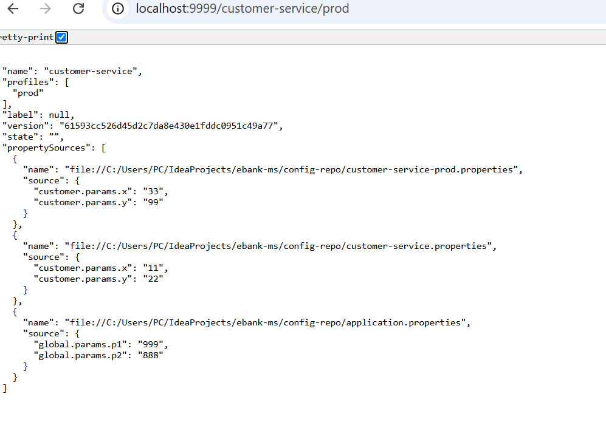

Les valeurs sont injectées avec `@Value`, et un bean annoté `@RefreshScope` peut être rechargé sans redémarrage :

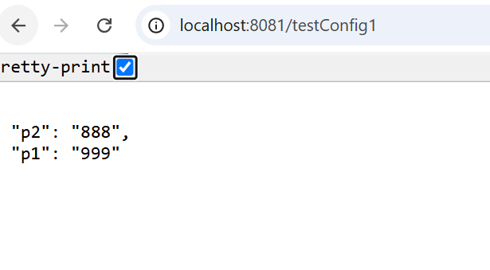

Après un commit dans le dépôt de configuration, un `POST /actuator/refresh` recharge les valeurs à chaud :

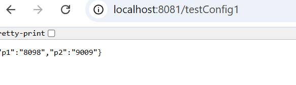

## 8. Lancer le projet

Démarrer dans cet ordre, chaque service avec `./mvnw spring-boot:run` :

1. `config-service` (9999)
2. `discovery-service` (8761)
3. `customer-service` (8081), `inventory-service` (8082), `billing-service` (8083)
4. `gateway-service` (8888)

| Outil | URL |
|---|---|
| Eureka | `http://localhost:8761` |
| Clients via Gateway | `http://localhost:8888/customers` |
| Facture via Gateway | `http://localhost:8888/BILLING-SERVICE/api/bills/1` |

## 9. Bilan

| Thème | Ce que j'ai retenu |
|---|---|
| Découverte | Eureka : chaque service s'enregistre, la Gateway le retrouve par son nom |
| Routage | `lb://` remplace les URL fixes et répartit la charge |
| Communication | OpenFeign : un appel inter-service = une interface |
| Résilience | Circuit Breaker + fallback : une panne partielle ne casse pas tout |
| Configuration | Config Service + Git + `@RefreshScope` : mise à jour sans redémarrage |

**Prochaines étapes du TP :** client Angular, sécurité avec Keycloak (OAuth2 / OIDC), conteneurisation avec Docker Compose, communication asynchrone avec Kafka, puis Kubernetes.
